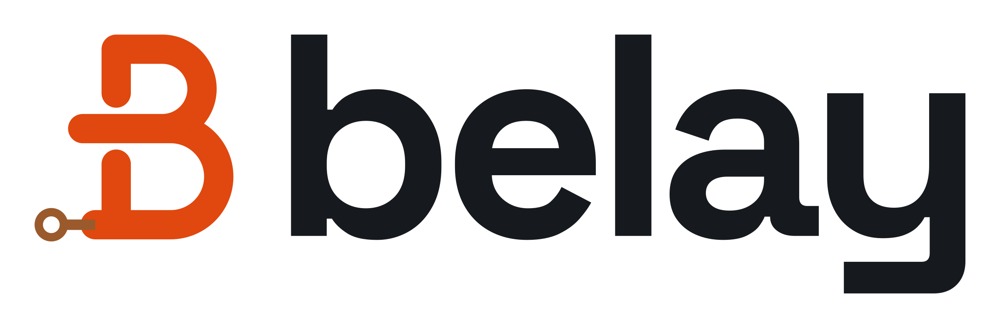

# Belay 

    <a id="banner-logo" href="https://github.com/dillonshephard/belay-lang">
        <picture>
            <source media="(prefers-color-scheme: dark)" srcset="./assets/branding/logo/svg/belay-lockup-horizontal-dark.svg?raw=true" type="image/svg+xml">
            <source media="(prefers-color-scheme: light)" srcset="./assets/branding/logo/svg/belay-lockup-horizontal-light.svg?raw=true" type="image/svg+xml">
            
        </picture>
    </a>

<h3 align="center">Firmware with a safety line.</h3>

 

> [!CAUTION]
> Belay is a heavily experimental project that is only currently intended for small embedded and IoT projects. 
> The language specification and even implmentation is subject to change between commits. It is not currently suitable 
> for any kind of critical hardware that relies on the long-term stability of the language. Changes will be thoroughly 
> documented and major revisions that may affect previous code will be clearly highlighted. Use Belay at your own discretion.

***
